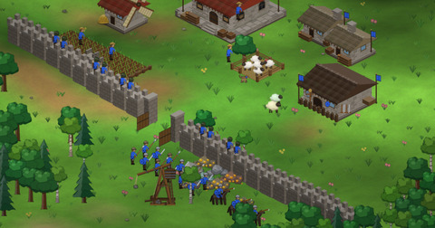

## Jan Kučera

Systems and protocol engineer in Ostrava, Czechia — consensus, cryptography, storage, P2P, and observability tooling.
Twelve years of Python, increasingly Rust.

### Protocols

**[bismuth](https://github.com/hclivess/bismuth)** — the first blockchain written from scratch in Python. Fair-launched 1 May 2017,
no ICO or premine, in production since. Full node stack, the Hypernode second layer, on-chain tokens, a DEX and bridges to Ethereum and BSC.

**[nado](https://github.com/hclivess/nado)** — phone-mineable, fair-launch, post-quantum chain. A beacon-keyed weighted draw replaces the
hash race, so faster hardware gives no advantage. ML-DSA-44 signatures, a STARK-proven zkVM, and a zero-install browser wallet and miner.
Hardware side: [nado-hardware](https://github.com/hclivess/nado-hardware).

Also: [HoboNickels](https://github.com/hclivess/HoboNickels) — a 2014 proof-of-stake coin revived on a modern toolchain.

### Research

- Kučera, Hovland — [Tail Removal Block Validation](https://doi.org/10.4173/mic.2018.3.1). *MIC* 39(3), 2018. Deployed on Bismuth mainnet.
- Hovland, Kučera — [Nonlinear Feedback Control of a Proof-of-Work Blockchain](https://doi.org/10.4173/mic.2017.4.1). *MIC* 38(4), 2017. Cited in IBM patent US 10,880,073.
- Kučera — [Proof of Secure Element Attestation Without a Certificate Authority](https://doi.org/10.5281/zenodo.22749219). Zenodo, 2026. Reference implementation: [posea](https://github.com/hclivess/posea).
- [stark-soundness-analysis](https://github.com/hclivess/stark-soundness-analysis) — concrete soundness modelling for FRI-based STARKs.
- [windows-tpm-claim-format](https://github.com/hclivess/windows-tpm-claim-format) — the undocumented Windows TPM key-attestation blob layout.
- [tropic01-explorer](https://github.com/hclivess/tropic01-explorer) — interactive explorer for the TROPIC01 secure element model.

### Desktop tools

Drop files in, press Start, get the result. Standalone builds for Windows, Linux and macOS on every release.

| | | |
|:---:|---|---|
|  | [whisperer](https://github.com/hclivess/whisperer) | Batch subtitle generator — Whisper on CPU or CUDA, speech-snapped timing, resync, muxing. |
|  | [summoner](https://github.com/hclivess/summoner) | Photo developer: raws or JPEGs in, developed photos out, per-photo auto analysis. |
|  | [diskmaster](https://github.com/hclivess/diskmaster) | Drive health monitor: SMART, health score, surface scans naming affected files. |
|  | [speech-splitter](https://github.com/hclivess/speech-splitter) | Raw recordings to TTS training datasets. Behind [Chatterbox-TTS-Czech](https://huggingface.co/Thomcles/Chatterbox-TTS-Czech). |
|  | [rtl-spectrum](https://github.com/hclivess/rtl-spectrum) | RTL-SDR receiver: listen, sweep, auto-record voice channels, ADS-B map. |
|  | [videer](https://github.com/hclivess/videer) | FFmpeg/AviSynth+ encoding GUI with QTGMC, CUDA and VMAF. |
|  | [video-duplicate-finder](https://github.com/hclivess/video-duplicate-finder) | Finds duplicate videos by perceptual fingerprint. |
|  | [nameer](https://github.com/hclivess/nameer) | Renames videos from their codec, resolution and language metadata. |
|  | [exifer](https://github.com/hclivess/exifer) | Sets photo and video dates from a fixed date, file name or metadata. |
|  | [11copy](https://github.com/hclivess/11copy) | Folder sync: backup, two-way, mirror; preview first, verified copies. |
|  | [edge-tts-gui](https://github.com/hclivess/edge-tts-gui) | Batch text-to-speech with Microsoft Edge voices. |
|  | [titulkovač](https://github.com/hclivess/titulkovac) | Repairs subtitle files and broken Czech charsets. |
|  | [ollama-batch-processor](https://github.com/hclivess/ollama-batch-processor) | Batch LLM pipelines over local Ollama. |
|  | [ezcoder](https://github.com/hclivess/ezcoder) | Hybrid post-quantum message encryption with Double Ratchet sessions. |
|  | [screen-monitor](https://github.com/hclivess/screen-monitor) · [mandatum](https://github.com/hclivess/mandatum) | Rust fleet tools for Windows: live screen monitoring, remote task execution. |

### Other tools

| | | |
|:---:|---|---|
|  | [dynatrace-mass-management](https://github.com/hclivess/dynatrace-mass-management) | Bulk operations across many Dynatrace tenants. |
| | [sshauto](https://github.com/hclivess/sshauto) | Lightweight SSH automation, an Ansible alternative. |
|  | [truewind](https://github.com/hclivess/truewind) | [Physics-first browser sailing simulator](https://hclivess.github.io/truewind/) with real coastlines and AI racing. |
|  | [age-of-gore](https://ageofgore.com) | Procedural Age of Empires II-style RTS in WebGL2 with a Rust relay. |
| | [rag-sqlite](https://github.com/hclivess/rag-sqlite) | Minimal, dependency-free RAG on SQLite. |
| | [discord-security-bot](https://github.com/hclivess/discord-security-bot) | Discord anti-spam with a daily Claude security review. |
| | [chatterbox-model-trainer](https://github.com/hclivess/chatterbox-model-trainer) | Trains Chatterbox-TTS voices from speech-splitter datasets. |

### Running in production

- [firmostat.cz](https://firmostat.cz) — Czech company database, 1M+ records from ARES and the public registers.
- [slopinky.cz](https://slopinky.cz) — auto-translated Czech current-events encyclopedia.

### Elsewhere

Eight-plus years of enterprise observability — Dynatrace, CheckMK, Nimsoft/Ekara — across estates of ~15,000 hosts.

[bismuth.cz](https://bismuth.cz) · [nadochain.com](https://nadochain.com) · [LinkedIn](https://www.linkedin.com/in/kucerjan) · kucera@protonmail.com
